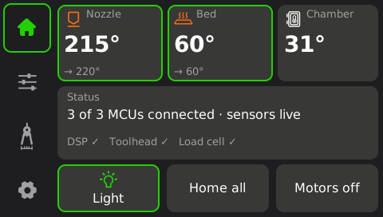

# ccos — lightweight native host for the Elegoo Centauri Carbon

A replacement for Elegoo's `/app/app`, written in Rust and built to be as light
as possible on the printer's 2x Cortex-A7 / 128 MB board:

* **one static binary** (~600 KB, ARMv7 musl), depending only on `libc`;
* an **English UI you edit as text** (`ui/*.toml`) and that is **compiled into
  the binary** — no runtime parsing, no font engine, no image decoder;
* **no allocation per frame or per MCU message**, redraws only what changed,
  sleeps in `poll()` when idle.

Background, protocol details and design notes: [`docs/re/`](../docs/re/README.md),
especially [08 — ccos](../docs/re/08-rust-host-roadmap.md).



**Status:** ccos contains a complete printing core — MCU sessions with clock
sync, Klipper's look-ahead planner, CoreXY step generation and compression,
PID heaters with runaway protection, homing, a G-code interpreter, file
printing with pause/resume/cancel — and prints in the **emulator**
([`ccsim`](../docs/re/09-emulator.md)), where end-to-end tests check heating,
homing, printed geometry and every safety shutdown. On the **real printer**
it has not been run yet, and heaters/motors stay locked
(`CCOS_ENABLE_MOTION=1` unlocks them — don't, see the roadmap): there it
shows live temperatures, switches the light, runs the hotend fan above
50 °C and probes/resets the MCUs.

## Layout

| Path | Ships to printer | What |
|---|---|---|
| `ui/` | compiled in | Theme, screens, fonts, icons — [how to edit](ui/README.md) |
| `crates/ccos` | ✓ | The app: UI runtime, printer core (planner, steps, heaters, homing), G-code, CLI tools |
| `crates/cc-ui` | ✓ | UI runtime: canvas, baked fonts, icons, framebuffer, touch, screen engine |
| `crates/cc-proto` | ✓ | Klipper protocol with the printer's fixed message table, zero-alloc |
| `crates/cc-transport` | ✓ | Serial links and the R528 DSP shared-memory link |
| `crates/cc-ui-codegen` | build only | `ui/` → static Rust |
| `crates/cc-sim`, `crates/ccsim` | PC only | The emulator: virtual MCUs + machine, window, test scripts ([docs](../docs/re/09-emulator.md)) |
| `sim/` | PC only | Emulator test scripts and sample G-code |
| `crates/ccres`, `cc-res`, `cc-gui` | PC only | Tools for the **stock** UI resources and MCU firmware images |

## Build

```sh
rustup target add armv7-unknown-linux-musleabihf
cargo test --release --workspace --all-features     # unit tests + emulator scenarios (~4 min)
cargo build --release --target armv7-unknown-linux-musleabihf -p ccos
# -> target/armv7-unknown-linux-musleabihf/release/ccos
cargo run --release -p ccos -- preview /tmp/screens  # render every screen on your PC
```

No cross C toolchain is needed (linked with `rust-lld`, see `.cargo/config.toml`).

## Try it without a printer

```sh
cargo run --release -p ccsim                    # window: the LCD (click = touch) + bed view
cargo run --release -p ccsim -- --speed 10      # heaters 10x faster
cargo run --release -p ccsim -- sim/scripts/03_print_cube.ccsim   # a scripted test, headless
```

The Print screen lists `cube_20mm.gcode` and two other samples; put your own
files in the G-code folder ccsim prints at start-up (or pass `--gcode-dir`).
`ccsim --help` lists every script command and value. Build without the
window (no X11) with `--no-default-features`.

## Run on the printer

Get a root shell with [OpenCentauri patched firmware](https://github.com/OpenCentauri/OpenCentauri)
(SSH `root` / `OpenCentauri`), then:

```sh
scp target/armv7-unknown-linux-musleabihf/release/ccos root@<printer>:/user-resource/
ssh root@<printer>
killall app                   # Elegoo's UI/host owns the screen and MCUs
/user-resource/ccos           # touchscreen UI
```

Reboot to get the stock firmware back. Other commands:

```sh
ccos probe all                # identify + clock-check DSP, toolhead, bed board
ccos console toolhead         # raw Klipper commands (type `help`)
ccos power-cycle toolhead     # reset an STM32 board and boot its firmware
ccos dsp-log                  # follow the DSP's printf output
ccos preview <dir>            # PNG of every screen
```

What happens on start: `ccos` refuses to touch the MCUs while `/app/app` runs.
Otherwise it restarts the DSP through remoteproc if another host attached to
it this boot (`--keep-dsp` disables that), power-cycles both STM32 boards and
releases them from Elegoo's bootloader, configures the thermistor ADCs, the
chamber light and the hotend fan, and starts the UI.

## PC tool for the stock firmware: `ccres`

```sh
R=../firmware/resources/e100
cargo run --release -p ccres -- widget list $R/widget.csv
cargo run --release -p ccres -- preview $R all previews/ --annotate
cargo run --release -p ccres -- widget compile my_widgets.csv widget.bin
cargo run --release -p ccres -- mcu info ../firmware/resources/firmware/upgrade_sg.bin
cargo run --release -p ccres -- proto decode 08 10 01 00 28 5e 9f 7e
```

See [docs/re/05-ui-resources.md](../docs/re/05-ui-resources.md).
