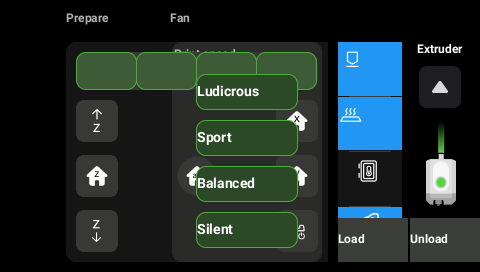
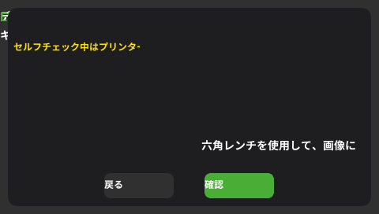

# 05 — UI resources and editing the stock UI

The stock UI is LVGL 8.3 at 480×272, but screens are not hand-coded: the
loader (`firmware/ui/loader/widget.c`) builds every LVGL object from
`widget.bin`, and screen code in `app/e100/*.cpp` only fills in dynamic
content and handles events by widget index.

## Files

| On device | Source in repo | Built by |
|---|---|---|
| `/app/resources/widget.bin` | `firmware/resources/e100/widget.csv` | `firmware/tools/widget` or `ccres widget compile` |
| `/app/resources/translation.bin` | `…/translation.csv` | `firmware/tools/tr` or `ccres tr compile` |
| `/app/resources/images/<n>.png` | `…/images/` (404 PNGs) | — |
| `/app/resources/fonts/font.ttc` | `…/fonts/font.ttc` (22 MB, 8 faces incl. CJK) | — |

`ccres` reproduces the shipped `widget.bin` **byte for byte** from
`widget.csv`, and round-trips both `.bin` files exactly (see the tests in
`ccos/crates/cc-res`).

## widget.csv / widget.bin

Tab-separated, first row is a header. One row per widget:

| Column | Meaning |
|---|---|
| 0 | Comment (designer's name for the widget; not stored in the .bin) |
| 1 | Window index (0 = system layer always on screen; 1 = home, 2 = control, …; 42 windows) |
| 2 | Widget index within the window — the `WIDGET_ID_*` used by `app/e100/*.cpp` |
| 3 | Type: 0 container, 1 button, 2 image, 3 label, 4 bar, 5 slider, 7 text area, 8 arc |
| 4–7 | x, y, w, h (relative to parent; w/h 0 = size to content) |
| 8, 9 | callback index, event index (unused, 0) |
| 10 | Flags `FLAG|MASK[:FLAG|MASK…]` in hex: `lv_obj_flag_t` bits, mask≠0 → add, 0 → clear (e.g. `00000002|00000000` clears CLICKABLE, `00000001|00000001` hides) |
| 11+ | Styles `PROP|VALUE|SELECTOR` (`#AARRGGBB` for colours, decimal otherwise; selector hex = LVGL part\|state, e.g. `0020` = pressed) |

**Important:** the C tool tokenises with `strtok`, so an *empty* column is
skipped and everything after it shifts left. Never leave a cell empty;
`ccres` mirrors this exactly.

### The PROP word

```
bit 19..17  sub-object: 0 = the widget, 1 = button's image, 2 = button's label
bit 16      custom (Elegoo) property
bit 15..0   LVGL lv_style_prop_t (id in bits 7..0, LVGL flag bits above)
```

Common values seen in the CSV:

| PROP | Meaning |
|---|---|
| 32 / 33 | bg_color / bg_opa |
| 96 | radius |
| 1111 | text_color (87 + inherit + layout flags) |
| 5213 | text_align (0 auto, 1 left, 2 center, 3 right) |
| 4103 / 4104 / 4105 | x / y / align of the widget |
| 135175 / 135176 / 135177 | x / y / align of a button's **image** |
| 266247 / 266248 / 266249 | x / y / align of a button's **label** |
| 65537 | custom `image_index` → `/app/resources/images/<value>.png` |
| 65538 | custom `tr_index` → translation string id |
| 65539 | custom `font_weight`: low byte = pixel size, high byte 1 italic / 2 bold |
| 65540 | custom `parent_index` → re-parent onto widget N of the same window |
| 65541–65552 | custom `align_out_*` relative to widget N (top-left … right-bottom) |

`ccres widget show widget.csv <window>` prints every widget with these decoded.

## translation.csv / translation.bin

Columns: id (1-based), font size (literally `\t` in the shipped file — unused),
then Chinese, English, Spanish, French, Italian, Russian, German, Japanese,
Korean, Turkish, Ukrainian, and an "end" column. `\n` in a cell becomes a line
break. The language index is `sysconf.cfg [system] language`. 466 strings.

Rows with fewer cells produce zero-length entries (shown as empty text).

## Workflow: restyle the stock UI

```sh
cd ccos && cargo build --release
R=../firmware/resources/e100

# 1. look at a screen
./target/release/ccres widget list $R/widget.csv
./target/release/ccres preview $R 2 control.png --annotate

# 2. edit $R/widget.csv (spreadsheet-friendly, keep tabs) or work in JSON:
./target/release/ccres widget decompile $R/widget.bin widgets.json
#    ... edit widgets.json ...

# 3. rebuild and preview
./target/release/ccres widget compile widgets.json widget.bin
./target/release/ccres preview $R 2 control_new.png

# 4. on the printer (root shell): back up, copy, restart the app or reboot
cp /app/resources/widget.bin /app/resources/widget.bin.orig
# copy widget.bin / translation.bin / images/*.png into /app/resources/
```

Rules of thumb:

* Don't change the number or order of widgets in a window unless you also
  change `app/e100/*.cpp` — code addresses widgets by index.
* Colours, positions, sizes, radii, fonts, icons and texts are safe to change.
* Replace an icon by overwriting `images/<n>.png` (keep RGBA PNG).
* Rename/translate anything by editing `translation.csv`.

The preview is an approximation (static data only: runtime-set texts/icons and
pages the app shows/hides are not simulated).



