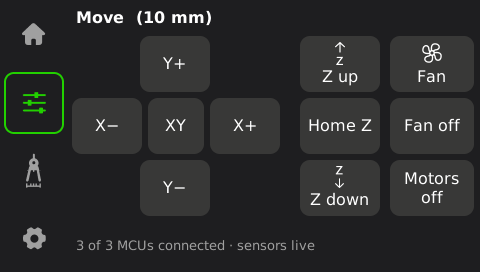
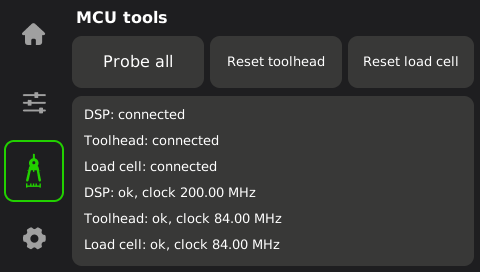
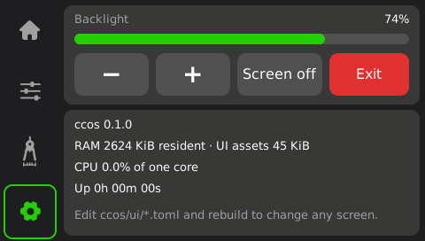

# 08 — `ccos`: a lightweight native host

"Your own OS" realistically means **your own userspace** on the existing
platform: the kernel, bootloader, DSP firmware and STM32 firmware already do
their jobs and are either signed, built with a proprietary toolchain, or plain
Klipper. Replacing `/app/app` gives full control of motion, UI and networking
while keeping the platform. `ccos/` is that replacement, built to be as light
as possible on a 2x Cortex-A7 / 128 MB board.

## Design rules

1. **Nothing is interpreted at runtime.** No Python, no scripting, no config
   parser in the hot path. The UI is described in `ccos/ui/*.toml` but
   compiled into the binary by `build.rs`; MCU message tables are compiled from
   JSON into static arrays.
2. **Nothing is allocated per frame or per message.** Frames, messages, text
   buffers and the frame decoder are fixed-size values. The only large
   allocation is one 480×272 back buffer (510 KiB), made once.
3. **Nothing is redrawn unless it changed.** The UI engine hashes each live
   widget's content; only changed rectangles are redrawn and copied to
   `/dev/fb0`. When idle, the main loop sleeps in `poll()` on the touch device.
4. **Only `libc` ships.** Fonts are pre-rasterised to 4-bit glyphs, icons are
   pre-converted (single-colour ones to 4-bit masks), so no font engine, PNG
   decoder, TOML or JSON parser ends up on the printer.
5. **One static binary.** musl, LTO, `panic = abort`, `target-cpu=cortex-a7`.
   It runs regardless of the printer's glibc version.

Measured: the ARMv7 release binary is **~600 KB** static, of which **~45 KB**
is the whole UI (4 fonts with 110 glyphs each, 18 icons). `opt-level = "s"` would only save 7%, so
the build stays at `-O3`. Expected resident memory on the printer is about
1 MB (the back buffer plus small fixed buffers per MCU); not yet measured on
hardware.

## What exists now

| Crate | Ships to printer | Status |
|---|---|---|
| `cc-proto` | yes | Framing, CRC, VLQ, the fixed 115-message table as static arrays, zero-allocation encode/decode, clock helpers. Byte-exact against Elegoo's C (test vectors generated from `msgblock.c`). |
| `cc-transport` | yes | Serial (termios; hang-up detection) and the DSP shared-memory link (once-per-boot handshake, remoteproc restart, kbuf alloc/free, DSP log). Ring logic tested against a simulated DSP; serial tested on a pty; **DSP device ioctls untested on hardware**. |
| `cc-ui` | yes | Canvas, baked-font text, icons, framebuffer (dirty rects), evdev touch, screen engine, tiny PNG writer. |
| `cc-ui-codegen` | no (build only) | `ui/*.toml` + TTF + PNG → static Rust. Validates everything with readable errors. |
| `ccos` | yes | The app: touchscreen UI, printer core (MCU sessions with windowed send queue and clock sync, Klipper look-ahead planner, CoreXY step generation + compression, PID heaters with `verify_heater`, homing via trsync, G-code interpreter, file printing), CLI tools. Printing is tested end to end in `ccsim`; **locked off on real hardware** (see below). |
| `cc-sim`, `ccsim` | no (PC) | The [emulator](09-emulator.md): firmware-accurate virtual MCUs on ptys, physics model of the machine, window and test scripts. |
| `ccres`, `cc-res`, `cc-gui` | no (PC tools) | Stock UI resources (`widget.bin`, `translation.bin`), MCU update images, protocol encode/decode, stock-screen previews. |

 
  

On the real printer `ccos` drives only **read-only sensors, the chamber light
and the hotend cooling fan** (on from 50 °C, off below 45 °C, like the stock
`heater_fan`) unless `CCOS_ENABLE_MOTION=1` is set. The printing core —
heaters, motors, homing, file printing — runs and is tested in the emulator,
but has never moved a real printer.

## Compared with COSMOS

OpenCentauri's COSMOS already runs upstream Klipper/Kalico on the stock board
and prints well; its docs warn that the board has "very little overhead" left
for anything else. `ccos` takes the opposite trade-off: a single native process
with no interpreter, built for minimal CPU and RAM. That makes it attractive
for a fast, responsive printer, but it means re-implementing what Klipper does.
Until `ccos` prints, use COSMOS or the patched stock firmware for real jobs.

## What a printing host still needs

In dependency order. Steps 2–6 and 9 now exist and pass the emulator's
end-to-end tests ([09](09-emulator.md)); what remains open in them is noted.

1. **On-device validation of the links** — run `ccos probe all` with the stock
   app stopped. Expect fixes around the DSP restart path (where remoteproc loads
   the image from) and the bootloader timing of the STM32 boards.
2. ✅ **Windowed, clock-scheduled send queue** (`mcu.rs`) and **clock sync**.
3. **MCU configuration from a config file** — today the machine is described
   in `machine.rs` (from the stock `printer.cfg`); reading `printer.cfg` so
   stock calibrations carry over, and the config CRC, are still to do.
4. ✅ **Heaters + safety** (`heater.rs`): PID, soft PWM with MCU-side
   `max_duration`, ADC range limits, `verify_heater`. Each layer is triggered
   on purpose in `sim/scripts/04_faults.ccsim`. The bed is mains-powered
   through an SSR: validate on hardware with care.
5. ✅ **Steppers** (`motion/stepper.rs`): compression within 25 µs,
   direction changes, `reset_step_clock`, move-queue slot
   accounting. Still to do on the device: run the I/O thread `SCHED_FIFO`.
6. ✅ **Kinematics & planning** (`motion/`): Klipper's look-ahead and CoreXY.
   Step times come from the stock trapq/itersolve with input shaping and
   pressure advance, generated `kin_flush_delay` behind the planner as the
   stock toolhead does.
7. ✅ **TMC2209 over UART** (`tmc.rs`, `gcode/tmc.rs`): a port of the
   stock driver code. It covers the connect-time register set, the
   StallGuard switching around homing, `SET_TMC_CURRENT_*`, `INIT_TMC`,
   `SET_TMC_FIELD`, `DUMP_TMC` and IFCNT-checked writes. Homing uses the
   stock trsync protocol, trdispatch included. Both are tested against
   the emulator's driver model; neither has been checked on a real
   printer yet.
8. **Load-cell probing** — the hard, Centauri-specific part.
   - 🟡 Done: Z probing (`loadcell.rs`, `gcode/loadcell.rs`).
     - Tare and trigger run on the load-cell board (`hx711s.c` does the
       filtering and the knee search; the host only reads `sg_resp`).
     - Z is stepped directly through `dirzctl`.
     - Ported: `STRAINGAUGE_Z_HOME`, `STRAINGAUGE_TEST`, `DIRZCTL`,
       `READ_HX711`, and G28 with `enable_z_home`.
     - Tested against the emulator's port of the board firmware; not
       yet on a printer.
   - 🟡 Done: the bed mesh (`mesh.rs`, `gcode/mesh.rs`).
     - `BED_MESH_CALIBRATE` and G29 probe with the load cells as the stock
       firmware does (`run_G29_Z`, samples/tolerance/retries,
       `METHOD=fast`).
     - The mesh is interpolated (bicubic/Lagrange) and every G-code move
       follows it (the stock move splitter).
     - Profiles are saved as `besh_profile_*` sections. `BED_MESH_SET_INDEX`
       runs at boot.
     - ccos additions: `BED_MESH_CALIBRATE [S<°C>] [name]`, `G29 S<°C>`,
       and a Bed mesh screen that shows the saved profiles.
     - Tested against the emulator with a tilted, domed bed; not yet on a
       printer.
   - 🟡 Done: the remaining probe commands (`gcode/probe.rs`,
     `gcode/bedcheck.rs`): `PROBE`, `PROBE_ACCURACY`, `HOME_ACCURACY`,
     `PROBE_CALIBRATE`, `QUERY_PROBE`, `CALIBRATE_Z_OFFSET`,
     `LIFT_HOT_BED`, `PRTOUCH_READY`, `CHECK_BED_MESH`,
     `MEASURE_GAP_TEST`, `NOZZLE_CLEAR`. Tested in the emulator
     (`12_probe`), not yet on a printer.
   - 🟡 Done: the accelerometer and the resonance test (`accel.rs`,
     `resonance.rs`, `gcode/accel.rs`, `gcode/resonance.rs`): the
     LIS2DW12 on the toolhead MCU, `ACCELEROMETER_*_X`,
     `ADXL345_DEBUG_*_X`, Elegoo's pulse test and the mzv fit
     (`TEST_RESONANCES`, `SHAPER_CALIBRATE`, `SHAPER_CALIBRATE_SCRIPT`,
     `MEASURE_AXES_NOISE`). Tested against a virtual LIS2DW12 on a
     ringing toolhead (`13_resonance`), not yet on a printer.
   - 🟡 Done: the Calibration screen (Tools → Calibrate,
     `ui/screens/calibrate.toml`): the stock auto-level, PID, vibration
     and one-click pages on one screen, fed by the stock progress states.
     Tested in the emulator (`14_calibration`), not yet on a printer.
9. ✅ **G-code interpreter** (`gcode/`, `config.rs`): a port of the stock
   one. It has the same parser, the full command set the Centauri Carbon
   loads, and the same defaults, range checks and internal scripts (G28,
   PAUSE/RESUME, M600, PID_CALIBRATE…). It also covers the file pipeline,
   the ROOT gate and M8000–M8826 on the stock config files. Coverage and
   deliberate differences: [10](10-gcode.md). Power-loss resume
   (`break_save`: watcher, save file, boot prompt, `STOP_RESUME`) is
   ported; tested in the emulator (`11_power_loss`), not yet on a printer.
   With the accelerometer, every command the printer registers is
   implemented.
10. **Network** — Moonraker-compatible HTTP/websocket API (works with
    OrcaSlicer, Mainsail, Fluidd) and/or SDCP (websocket on :3030, UDP
    discovery on :3000; documented in OpenCentauri `docs/software/api.md`).
11. **Camera/timelapse** — V4L2 MJPEG passthrough is cheap; avoid re-encoding
    on the A7.

## Safety

Heaters and motion are physical. On the real printer `ccos` configures only
the chamber light and the hotend cooling fan unless you set
`CCOS_ENABLE_MOTION=1`. Don't set it until each piece has been checked on
the machine with someone watching. The TMC2209 setup now exists, but it has
only been tested in the emulator. A sensible order:
1. Connect only. Every driver write is verified through IFCNT; look for
   `Unable to write tmc uart` or `failed to init` in the log.
2. Short single moves of each axis.
3. Then homing. Keep a way
back to the stock `app` (it stays on disk; a reboot restores it unless you
change the init scripts).
